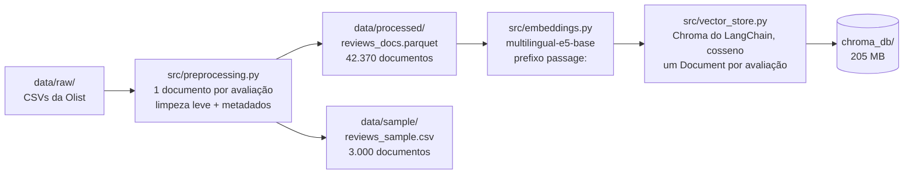
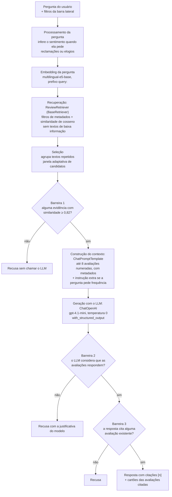
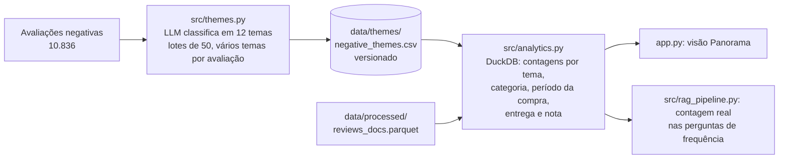

# Arquitetura da solução

Este documento descreve como a solução está organizada: os dois fluxos (construção da base e resposta a perguntas), o papel de cada módulo e os parâmetros que definem o comportamento do sistema. As justificativas de cada escolha estão no [README](../README.md), na parte "Decisões técnicas por etapa", e o processo de construção está em [processo.md](processo.md).

## Visão geral

A solução tem dois fluxos independentes:

1. **Construção da base de conhecimento**, executada uma vez: transforma os CSVs da Olist em documentos, gera os embeddings e grava o índice vetorial.
2. **Resposta a perguntas**, executada a cada pergunta: busca as avaliações relevantes, monta o contexto, gera a resposta com o LLM e confere as citações.

Os dois fluxos se comunicam apenas pelo índice persistido em `chroma_db/`.

## Fluxo 1: construção da base de conhecimento

| Passo | Script | Tempo (CPU) | Saída |
| --- | --- | --- | --- |
| Preparo da base | `python scripts/prepare_data.py` | cerca de 5 s | `data/processed/reviews_docs.parquet` e a amostra |
| Embeddings e índice | `python scripts/build_index.py` | cerca de 11 min | `chroma_db/` |

Cada avaliação vira **um documento**: título e comentário juntos, sem divisão em pedaços (*chunking*), porque nenhum comentário passa de 188 tokens. O documento é gravado no Chroma com três partes:

- o **vetor** de 768 dimensões, usado na busca;
- o **texto original** (com limpeza leve), mostrado como evidência;
- os **metadados**: nota, sentimento, status do pedido e da entrega, dias de atraso, categoria do produto, datas da compra e da avaliação e a marca de baixa informação. São usados nos filtros (o período usa a data da compra) e na citação.

## Fluxo 2: resposta a uma pergunta

O enunciado do desafio descreve o fluxo esperado em sete etapas. A tabela mostra onde cada uma está implementada:

| Etapa do enunciado | Onde está | O que acontece |
| --- | --- | --- |
| Pergunta do usuário | `app.py`, `scripts/ask.py` | Campo de texto, exemplos e filtros |
| Processamento da pergunta | `src/retrieval.py`: `infer_sentiment`, `build_where` | Inferência do sentimento e conversão dos filtros para a consulta do Chroma |
| Representação vetorial | `src/embeddings.py`: `E5Embeddings.embed_query` (componente `Embeddings` do LangChain) | Embedding da pergunta com o prefixo `query:` |
| Recuperação das avaliações | `src/retrieval.py`: `ReviewRetriever.search` (um `BaseRetriever` do LangChain sobre o `Chroma`) | Busca por similaridade de cosseno dentro dos filtros |
| Construção do contexto | `src/rag_pipeline.py`: `PROMPT` (um `ChatPromptTemplate`), `prompt_inputs`, `format_evidence` | Avaliações numeradas, com metadados, e instruções do sistema |
| Geração da resposta | `src/llm.py`: `build_llm` | `ChatOpenAI` na Responses API, com `with_structured_output(RagAnswer)` |
| Resposta fundamentada | `src/rag_pipeline.py`: `build_chain` (a cadeia LCEL), `check_citations` | Conferência das citações e montagem da resposta com as evidências |

## Fluxo 3: frequência por tema

Executado uma vez, à parte do fluxo de perguntas. Mede quanto cada problema aparece nas avaliações negativas.

Nas perguntas de frequência sobre reclamações, a cadeia do fluxo 2 consulta essas contagens com os mesmos filtros da busca e as inclui no contexto enviado ao LLM, que é instruído a copiá-las exatamente; o código confere cada porcentagem da resposta. Sem evidência acima do corte, essas perguntas usam exemplos dos temas mais frequentes, em vez de serem recusadas.

Os temas foram descobertos antes por agrupamento automático (`scripts/compare_clustering.py`), que se mostrou inadequado para contar (README, "Frequência por tema").

## Módulos

| Arquivo | Responsabilidade |
| --- | --- |
| [src/preprocessing.py](../src/preprocessing.py) | Lê os CSVs, monta um documento por avaliação, limpa o texto, cria a versão normalizada para comparação, marca os textos de baixa informação e junta os metadados do pedido |
| [src/embeddings.py](../src/embeddings.py) | Componente `Embeddings` do LangChain: gera os embeddings E5, com os prefixos `passage:` e `query:` e vetores normalizados |
| [src/vector_store.py](../src/vector_store.py) | Abre o índice pelo `Chroma` do LangChain, converte as avaliações em `Document`s, grava em lotes com `upsert` e impede reabrir o índice com outro modelo de embeddings |
| [src/retrieval.py](../src/retrieval.py) | `ReviewRetriever`, um `BaseRetriever` do LangChain: filtros, inferência do sentimento, busca, agrupamento de repetições e corte de similaridade |
| [src/llm.py](../src/llm.py) | O `ChatOpenAI` do LangChain e o formato estruturado da resposta |
| [src/themes.py](../src/themes.py) | Lista de temas das reclamações, com definições, e a cadeia que classifica avaliações em lotes com saída estruturada |
| [src/analytics.py](../src/analytics.py) | Contagens por tema, categoria, período da compra, status da entrega e nota, em SQL com DuckDB |
| [src/rag_pipeline.py](../src/rag_pipeline.py) | O `ChatPromptTemplate` e a cadeia LCEL com as três barreiras: busca, `RunnableBranch` da recusa, prompt, LLM e conferência das citações |
| [app.py](../app.py) | Interface em Streamlit, com duas visões: Perguntar (resposta, evidências e etapas do pipeline) e Panorama (frequência dos temas das reclamações) |

| Script | Uso |
| --- | --- |
| [scripts/prepare_data.py](../scripts/prepare_data.py) | Gera a base de documentos e a amostra |
| [scripts/build_index.py](../scripts/build_index.py) | Gera os embeddings e o índice |
| [scripts/ask.py](../scripts/ask.py) | Faz perguntas pelo terminal |
| [scripts/compare_search.py](../scripts/compare_search.py) | Experimento E5 × BM25 (Achado 1) |
| [scripts/calibrate_threshold.py](../scripts/calibrate_threshold.py) | Calibração do corte de recusa |
| [scripts/evaluate_rag.py](../scripts/evaluate_rag.py) | Avaliação do fluxo completo e comparação de modelos |
| [scripts/compare_clustering.py](../scripts/compare_clustering.py) | Experimento de agrupamento das reclamações (K-Means, HDBSCAN, BERTopic) |
| [scripts/classify_themes.py](../scripts/classify_themes.py) | Classificação das reclamações por tema, com validação |

As dependências vão sempre das peças básicas para as compostas: `vector_store` usa `embeddings`; `retrieval` usa `embeddings` e `preprocessing`; `rag_pipeline` usa `retrieval`, `llm` e `preprocessing`. A interface e os scripts usam os módulos, mas nenhum módulo de `src/` depende deles.

## Parâmetros principais

| Parâmetro | Valor | Onde | Como foi definido |
| --- | --- | --- | --- |
| Modelo de embeddings | `intfloat/multilingual-e5-base` (768 dimensões, até 512 tokens) | `src/embeddings.py` | Comparação de famílias de representação e de tamanhos do modelo (README, "Embeddings e índice vetorial") |
| Métrica de distância | Cosseno | `src/vector_store.py` | Métrica de treino do E5 |
| Corte de similaridade | 0,82 | `src/retrieval.py` | Calibração com 82 perguntas (README, "Calibração do corte de recusa") |
| Evidências por resposta (`k`) | 8 | `src/retrieval.py` | Configurável na interface, de 3 a 15 |
| Janela de candidatos | 4 × `k`, dobrando até 512 | `src/retrieval.py` | Correção do caso "não recebi o produto" (README, "Busca das evidências") |
| Modelo de linguagem | `gpt-4.1-mini` | `src/llm.py`, `OPENAI_MODEL` | Avaliação com 95 perguntas contra o `gpt-5.4-mini` (README, "Avaliação e escolha do modelo") |
| Temperatura | 0 | `src/llm.py`, `LLM_TEMPERATURE` | Reprodutibilidade e fidelidade às evidências |

## Dados e artefatos

| Caminho | Conteúdo | Versionado |
| --- | --- | --- |
| `data/raw/` | CSVs originais da Olist | Sim |
| `data/processed/reviews_docs.parquet` | Base de documentos completa | Não (gerada por `prepare_data.py`) |
| `data/sample/reviews_sample.csv` | Amostra de 3.000 documentos, estratificada por nota | Sim |
| `chroma_db/` | Índice da base completa | Não (gerado por `build_index.py`) |
| `chroma_db_sample/` | Índice da amostra, para o experimento E5 × BM25 | Não |
| `data/eval/threshold_questions.csv` | 82 perguntas da calibração e da avaliação | Sim |
| `data/eval/rag_results.csv` | Respostas da avaliação dos dois modelos | Sim |
| `data/themes/negative_themes.csv` | Temas de cada avaliação negativa | Sim (refazer custa dinheiro e não sai idêntico) |
| `.env` | Chave da OpenAI | Não (modelo em `.env.example`) |

## Pontos de extensão

A organização em módulos com interfaces pequenas permite evoluir partes isoladas:

- **Outro provedor de LLM** (Claude, por exemplo): basta trocar o `ChatOpenAI` por outro modelo de chat do LangChain, como o `ChatAnthropic`, em `src/llm.py`, sem mudar a cadeia.
- **Outro banco vetorial** (Qdrant, pgvector): basta outra implementação de `VectorStore` do LangChain, com a troca restrita a `src/vector_store.py` e à consulta em `src/retrieval.py`.
- **Busca híbrida** (E5 + BM25): um segundo recuperador combinado em `src/retrieval.py`.
- **Análises quantitativas** (frequência por tema): um módulo novo que lê a base de documentos e os embeddings, sem passar pelo fluxo de resposta.
