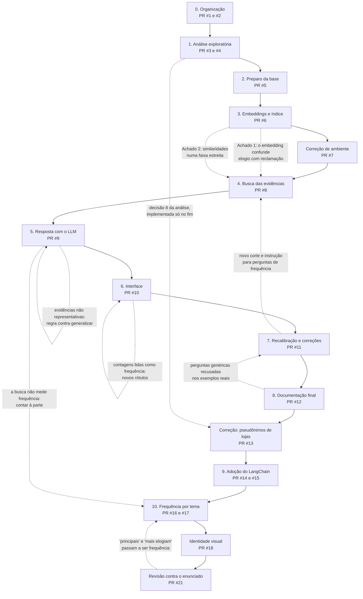

# Processo de construção do projeto

Este documento registra **como** a solução foi construída: as etapas, a ordem em que aconteceram, as decisões de cada uma e, principalmente, as descobertas que obrigaram a voltar e mudar etapas anteriores. O objetivo é mostrar o raciocínio por trás do resultado. O que a solução faz está no [README](../README.md), e como ela está organizada, em [arquitetura.md](arquitetura.md).

## Princípios de trabalho

1. **Uma etapa por vez, cada uma numa branch e numa pull request.** Cada PR entrega uma parte funcional e documentada, e só é mesclada depois de revisada pelo grupo. O histórico do repositório é, ele próprio, o registro do processo.
2. **Nenhuma decisão sem alternativa e sem evidência.** Cada escolha relevante foi comparada com pelo menos uma alternativa, e sempre que possível a comparação foi medida, e não apenas argumentada.
3. **Experimentos reproduzíveis.** Toda medição citada na documentação vem de um script ou notebook versionado, que qualquer pessoa pode executar para obter os mesmos números.
4. **Separar escolha e verificação.** Os parâmetros calibrados com dados foram escolhidos numa metade das perguntas e conferidos na outra, que não participou da escolha.
5. **Correções em branch própria.** Quando uma descoberta exigiu corrigir algo já mesclado, a correção ganhou uma branch e uma PR separadas, com a descoberta descrita no commit. O histórico mostra o erro e a correção, em vez de escondê-los.
6. **Testes automatizados sem custo.** Os testes usam um gerador de embeddings e um LLM falsos, então rodam em segundos, sem baixar o modelo e sem chamar a API. As chamadas reais ficam restritas aos scripts de avaliação.

## Visão geral

As setas contínuas são a ordem das etapas. As tracejadas são as **realimentações**: descobertas feitas numa etapa que mudaram uma etapa anterior ou a própria etapa. A mais importante veio da etapa de documentação: ao gerar exemplos reais, descobrimos que perguntas genéricas eram recusadas, o que levou à recalibração da busca (PR #11).

## Linha do tempo

| PR | Data | Branch | Etapa | Entrega |
| --- | --- | --- | --- | --- |
| #1 | 16/10/2026 | `chore/gitignore` | 0. Organização | Regras do que não vai para o repositório |
| #2 | 16/10/2026 | `chore/dados-olist` | 0. Organização | Base da Olist versionada e enunciado do desafio |
| #3 | 22/10/2026 | `feature/eda-avaliacoes` | 1. Análise exploratória | Notebook de análise das avaliações |
| #4 | 29/10/2026 | `feature/eda-tecnicas-e-decisoes` | 1. Análise exploratória | Técnicas de PLN usadas e decisões avaliadas |
| #5 | 31/10/2026 | `feature/preprocessing` | 2. Preparo da base | Base de 42.370 documentos com metadados |
| #6 | 31/10/2026 | `feature/embeddings-index` | 3. Embeddings e índice | Índice vetorial e comparação E5 × BM25 |
| #7 | 31/10/2026 | `fix/requirements-sentence-transformers` | Correção | Versão declarada alinhada ao ambiente testado |
| #8 | 31/10/2026 | `feature/retrieval` | 4. Busca | Filtros, agrupamento de repetições e corte calibrado |
| #9 | 01/11/2026 | `feature/rag-openai` | 5. Resposta | LLM com citações conferidas e avaliação de modelos |
| #10 | 04/11/2026 | `feature/streamlit-app` | 6. Interface | Tela com evidências e etapas do pipeline |
| #11 | 04/11/2026 | `fix/perguntas-genericas` | 7. Correções | Recalibração com perguntas genéricas e instrução de frequência |
| #12 | 05/11/2026 | `docs/documentacao-final` | 8. Documentação | Este documento, arquitetura e README reorganizado |
| #13 | 05/11/2026 | `fix/pseudonimos-lojas` | Correção | Instrução sobre os pseudônimos de lojas no prompt |
| #14 | 05/11/2026 | `refactor/langchain-busca` | 9. Adoção do LangChain | Embeddings, índice e busca com os componentes do LangChain |
| #15 | 05/11/2026 | `refactor/langchain-cadeia` | 9. Adoção do LangChain | Prompt, LLM e cadeia LCEL; comparação medida das duas vias |
| #16 | 05/11/2026 | `feature/temas-frequencia` | 10. Frequência por tema | Agrupamento testado, classificação pelo LLM, contagens com DuckDB |
| #17 | 05/11/2026 | `feature/temas-na-interface` | 10. Frequência por tema | Visão Panorama e contagem real nas respostas a perguntas de frequência |
| #18 | 06/11/2026 | `feature/visual-noturno` | Identidade visual | Tema escuro com destaque magenta, cores conferidas por contraste e paletas validadas |
| #19 | 06/11/2026 | `docs/roteiro-video` | Documentação | Roteiro do vídeo e Pydantic declarado nas dependências |
| #20 | 06/11/2026 | `docs/autores` | Documentação | Identificação dos autores e do grupo |
| #21 | 06/11/2026 | `fix/sintonia-enunciado` | Revisão contra o enunciado | Valores ausentes explícitos, detector de frequência ampliado, exemplo de exploração de volta e mapa de correspondência |

## Etapas

### 0. Organização (PR #1 e #2)

O repositório começou com as regras de versionamento e com os dados. Os CSVs da Olist foram versionados em `data/raw/`, para que o projeto rode sem depender de um download do Kaggle. A única exceção é o arquivo de geolocalização (61 MB), que a solução não usa.

### 1. Análise exploratória (PR #3 e #4)

**Objetivo:** entender as avaliações antes de decidir como transformá-las em base de conhecimento.

O notebook [01_eda_avaliacoes.ipynb](../notebooks/01_eda_avaliacoes.ipynb) mediu quantas avaliações têm texto (cerca de 43%), o tamanho dos comentários (mediana de cerca de 53 caracteres), as duplicatas (cerca de 1 em cada 5 comentários repete outro), os valores ausentes e quais metadados se associam à insatisfação. Usou Bag of Words e TF-IDF para ver o vocabulário e o que distingue as avaliações negativas.

O resultado foi uma tabela de **14 decisões de preparo**, cada uma ligada ao achado que a motivou. Duas delas foram tratadas como decisões avaliadas, com as duas opções comparadas antes da escolha:

- **Excluir as avaliações que têm só título?** Avaliamos e decidimos manter. São cerca de 1,7 mil avaliações, bem mais positivas que as demais (71% de nota 5, contra 51%). Excluí-las retiraria sobretudo elogios de uma base que já tem negativas em excesso, e os títulos negativos ("Não recebi o produto") são evidência direta.
- **Excluir as avaliações de pedidos sem itens?** Avaliamos e decidimos manter. São pedidos reais e pagos, quase todos de produtos indisponíveis ou cancelados, e 81% das avaliações são negativas. O texto é evidência das falhas mais graves, como venda sem estoque, mesmo sem produto e categoria nos metadados.

A PR #4 acrescentou ao notebook a explicação das técnicas de PLN usadas, onde e por quê. Ela também registrou por que BoW e TF-IDF ficariam na análise e não na busca: eles não capturam sentido ("recebi" e "não recebi" ficam quase iguais).

### 2. Preparo da base (PR #5)

**Objetivo:** aplicar as decisões da análise e gerar os documentos do RAG.

O módulo `src/preprocessing.py` gerou 42.370 documentos, um por avaliação com título ou comentário, com limpeza leve (preservando acentos, caixa, emojis e negações), texto normalizado à parte para comparar repetições, marca de baixa informação e metadados do pedido. O status da entrega foi definido por etapa do fluxo do pedido, separando, por exemplo, "entregue sem data registrada" de "enviado e não recebido". Também foi gerada uma amostra de 3.000 documentos, estratificada por nota, para testes rápidos.

### 3. Embeddings e índice (PR #6)

**Objetivo:** transformar cada avaliação num vetor e montar o índice de busca.

Foram comparadas quatro famílias de representação de texto (esparsa, vetores de palavra estáticos, BERT sem treino para busca e embedding de sentença) e quatro modelos de embedding. A escolha foi o `multilingual-e5-base`, local, e o ChromaDB como banco vetorial. A medição dos comentários em tokens (máximo de 188, contra o limite de 512 do modelo) confirmou a decisão de não dividir os textos.

Ainda nesta etapa, rodamos buscas reais no índice antes de seguir. Esse teste produziu os três achados que definiram a etapa seguinte (ver "Descobertas" abaixo). O Achado 1 virou um experimento formal: o E5 comparado ao BM25, a linha de base padrão em recuperação de informação, com e sem filtro.

### Correção de ambiente (PR #7)

Ao conferir o ambiente virtual do projeto, encontramos o `sentence-transformers` na versão 6.1, fora do limite `<6` declarado no `requirements.txt`. Testamos a versão 6.1, os resultados documentados se reproduziram exatamente, e o limite foi ampliado numa PR própria.

### 4. Busca das evidências (PR #8)

**Objetivo:** transformar os achados da etapa 3 numa busca confiável.

A busca passou a inferir o sentimento quando a pergunta pede um lado, a excluir os textos de baixa informação, a agrupar comentários repetidos e a aplicar um corte de similaridade abaixo do qual o sistema recusa a pergunta. O corte foi calibrado com 60 perguntas (dentro do tema, fora do tema e armadilhas), divididas em calibração e validação. Nesta etapa houve três correções de rumo: o critério do corte, a janela de candidatos e a base usada como padrão (ver "Descobertas").

### 5. Resposta com o LLM (PR #9)

**Objetivo:** gerar respostas fundamentadas, com citações conferidas e recusa quando não há evidência.

O pipeline ganhou três barreiras contra respostas sem base: a busca, o próprio LLM e a conferência das citações. O LLM responde num formato estruturado, que diz se respondeu ou recusou e quais avaliações citou. O prompt foi escrito regra por regra, cada uma ligada a um risco concreto, inclusive a injeção de instruções por meio dos comentários.

Dois modelos foram avaliados com as perguntas da calibração e com um teste de injeção. A leitura das respostas, além das métricas, levou a uma mudança no prompt e pesou na escolha do modelo (ver "Descobertas").

### 6. Interface (PR #10)

**Objetivo:** permitir que gestores façam perguntas e auditem a origem de cada resposta.

A tela mostra a resposta, um cartão para cada avaliação citada e uma seção com cada etapa do pipeline: filtros, candidatos acima e abaixo do corte, o contexto exato enviado ao LLM e a decisão. Um teste automatizado da interface, com o índice real, revelou um limite técnico do Chroma, e a revisão do grupo apontou que os números da tela podiam ser lidos como frequência (ver "Descobertas").

### 7. Recalibração e correções (PR #11)

**Objetivo:** corrigir as falhas encontradas ao usar o sistema com perguntas reais.

Esta etapa não estava no plano. Ela nasceu da etapa 8: ao gerar exemplos reais para a documentação, a pergunta "Quais as principais reclamações?", com filtro de categoria, foi recusada. A investigação mostrou que o conjunto de calibração não tinha perguntas genéricas. O conjunto passou de 60 para 82 perguntas, o critério ganhou uma margem de segurança e o corte foi de 0,84 para 0,82. A mesma rodada corrigiu as respostas a perguntas de frequência e um texto ambíguo da interface, e acrescentou à avaliação a detecção de palavras de outros alfabetos.

### 8. Documentação final

**Objetivo:** reunir instalação, arquitetura, tecnologias, exemplos e processo, como pede o enunciado.

Além de reorganizar a documentação, esta etapa conferiu as decisões da análise exploratória contra o código. Uma delas não tinha sido implementada (ver a descoberta 17).

### Correção: pseudônimos de lojas (PR #13)

A decisão 8 da análise exploratória previa que o prompt explicasse que "lannister", "stark", "baratheon" e "targaryen" são pseudônimos que a Olist usou para anonimizar lojas parceiras. Antes de corrigir, medimos o efeito da falta da instrução com 5 perguntas sobre essas lojas: nenhuma resposta avisava que o nome era um pseudônimo. Depois da nova regra no prompt, as 5 avisavam. A avaliação completa foi refeita com os dois modelos, para confirmar que a mudança no prompt não piorou nenhuma outra métrica, e ganhou as 5 perguntas e uma verificação automática.

### 9. Adoção do LangChain (PR #14 e #15)

**Objetivo:** reescrever o pipeline com os componentes do LangChain, sem mudar o comportamento.

A primeira versão não usava o LangChain, por uma decisão registrada no README: o fluxo é curto e precisava de controle fino. A decisão foi revista porque o LangChain foi estudado em profundidade no curso e é a referência de mercado para RAG. Os riscos conhecidos foram aceitos e tratados: as mudanças frequentes de API (versões fixadas no `requirements.txt`) e o risco de alterar sem perceber um comportamento já calibrado (teste de regressão).

A reescrita foi dividida em duas PRs. Esta primeira cobre os embeddings (um componente `Embeddings`), o índice (o `Chroma` do `langchain-chroma`, que reaproveita o índice existente sem reindexar) e a busca (um `BaseRetriever`). **Antes de mudar qualquer linha, gravamos uma linha de base:** as evidências exatas devolvidas para 89 perguntas (as 82 da calibração, as 5 sobre lojas e 2 casos especiais). A reescrita só foi aceita quando as 89 voltaram idênticas: mesmas avaliações, mesma ordem, mesmas similaridades e mesmas repetições. A gravação também foi verificada: a amostra, reindexada do zero pelo LangChain, reproduziu o experimento E5 × BM25 e a calibração.

A primeira comparação deu diferença em todas as 89 perguntas, o que levou à descoberta 19.

A segunda PR reescreveu o restante: o prompt como `ChatPromptTemplate`, o LLM como `ChatOpenAI` com `with_structured_output` e o fluxo como uma cadeia LCEL, com um `RunnableBranch` para a barreira da busca. Como o LLM não é totalmente determinístico, a verificação teve duas camadas. A primeira, determinística: as mensagens enviadas ao LLM nas 89 perguntas voltaram idênticas, caractere por caractere. A segunda, na avaliação completa: as 88 perguntas tiveram a mesma decisão nos dois modelos (176 de 176), com os tokens de entrada idênticos em todas.

Com as duas versões completas e o comportamento comprovadamente igual, foi possível comparar as duas vias com medições: linhas de código, dependências, tempo, riscos e facilidade de evolução. A comparação está no README, em "Sem × com LangChain". Ela é um resultado do processo, e não estava planejada: a primeira versão não usou o LangChain por uma escolha técnica, e a comparação só existe porque essa escolha foi revista.

### 10. Frequência por tema (PR #16 e #17)

**Objetivo:** medir quanto cada problema aparece, porque a busca semântica traz exemplos, e não contagens, e duas perguntas do enunciado pedem frequência.

O plano era agrupar as avaliações negativas pelos embeddings e contar cada grupo. O experimento comparou K-Means, HDBSCAN e BERTopic e validou contra uma referência independente de não recebimento. Nenhum funcionou para contar (descoberta 20). O agrupamento ficou com o papel de descobrir os temas, e a contagem passou a ser feita por classificação: o LLM marca, em cada avaliação, os temas de uma lista fechada.

Antes de classificar a base inteira, um piloto com 300 avaliações mediu o custo, revelou avaliações que nenhum tema cobria (descoberta 21) e mostrou a estabilidade entre duas rodadas (89% idênticas). A leitura das divergências com a referência mostrou que a referência erra mais do que o LLM (descoberta 22). Depois da base inteira, o cruzamento com os dados do pedido serviu de segunda validação e revelou um achado de negócio (descoberta 23).

A segunda PR levou as contagens ao sistema: a visão Panorama na interface e a contagem real no contexto das perguntas de frequência sobre reclamações, com a conferência automática das porcentagens. Os testes reais revelaram uma recusa indevida em perguntas de frequência genéricas com filtro (descoberta 24), e a avaliação ampliada revelou que mudar as regras gerais do prompt afetava outras perguntas (descoberta 25).

## Descobertas que mudaram o rumo

Cada descoberta segue o mesmo formato: como apareceu, a evidência, o que mudou e onde está documentada em detalhe.

| # | Etapa | Descoberta | Como apareceu | Evidência | O que mudou |
| --- | --- | --- | --- | --- | --- |
| 1 | 3 | O embedding acerta o assunto, mas confunde elogio com reclamação | Buscas de teste no índice | "entrega atrasada, não chegou no prazo": 2 de 10 resultados relevantes sem filtro; 10 de 10 com o filtro de sentimento negativo | Filtros de metadados na busca e inferência do sentimento pela pergunta |
| 2 | 3 | A polaridade não é um defeito da técnica de representação | Experimento E5 × BM25 | O BM25 também acerta só 2 de 10 sem filtro e 9 de 10 com filtro | A correção é o filtro pela nota do cliente, e não trocar o embedding. O BM25 fica como candidato à busca híbrida |
| 3 | 3 | As similaridades do E5 ficam numa faixa estreita | Buscas de teste | Perguntas do tema entre 0,86 e 0,93; sem relação entre 0,80 e 0,85 | O corte de recusa precisa ser calibrado e combinado com o LLM |
| 4 | 3 | Textos sem conteúdo atraem perguntas fora do tema | Buscas de teste | "receita de bolo de chocolate" encontrou `*****` | Exclusão dos textos de baixa informação por padrão |
| 5 | 3 | Ambiente diferente do declarado | Conferência da `.venv` | `sentence-transformers` 6.1 instalado, limite declarado `<6` | PR #7: limite ampliado depois de reproduzir os resultados |
| 6 | 4 | O critério "maior acerto" recusava perguntas legítimas | Calibração do corte | O corte de 0,85 acertava mais, mas recusava 2 perguntas legítimas | Critério novo: o maior corte sem nenhuma recusa indevida. A recusa na busca é irreversível; o aceite indevido ainda passa pelo LLM |
| 7 | 4 | Comentários repetidos ocupavam a janela de busca | Teste com a base completa | "não recebi o produto" aparece dezenas de vezes e deixava só 3 evidências diferentes | Janela de candidatos adaptativa, que dobra até 512 |
| 8 | 4 | O corte depende do tamanho da base | Calibração na amostra e na base completa | Corte de 0,83 na amostra e 0,84 na base completa | O índice padrão passou a ser a base completa |
| 9 | 5 | As evidências não são uma amostra representativa | Leitura das respostas | "recomendariam a loja?": evidências com notas 3 a 5, embora 25,8% das avaliações sejam negativas | A regra contra generalizar passou a valer para toda pergunta |
| 10 | 5 | Um dos modelos generalizava mesmo com a regra | Comparação de modelos | O `gpt-5.4-mini` respondeu "Sim." a "recomendariam a loja?" | Pesou na escolha do `gpt-4.1-mini` |
| 11 | 6 | O Chroma não lê 42 mil metadados de uma vez | Teste automatizado da interface | Erro do SQLite: "too many SQL variables" | Leitura em lotes de 5.000 |
| 12 | 6 | As contagens da tela podiam ser lidas como frequência | Revisão do grupo ao usar a interface | A tela mostrava "repetido em 98 avaliações"; a base tem 107 cópias exatas e 2.127 avaliações sobre não recebimento (19,6% das negativas) | Rótulos "ao menos N", nota explicativa e o exemplo no aviso de frequência |
| 13 | 8 → 7 | Perguntas genéricas eram recusadas | Exemplos reais para a documentação | "Quais as principais reclamações?" com filtro de móveis: similaridade 0,825, abaixo do corte de 0,84 | Conjunto de calibração ampliado para 82 perguntas, margem de segurança e corte de 0,82 |
| 14 | 8 → 7 | O LLM inventava um ranking em perguntas de frequência | Exemplos reais para a documentação | "As reclamações que aparecem com maior frequência são...", a partir de 8 exemplos | Instrução extra no contexto quando a pergunta pede frequência |
| 15 | 7 | Um texto da interface parecia um diagnóstico da pergunta | Revisão do grupo ao usar a interface | A regra sobre textos de baixa informação aparecia junto da recusa de "Qual a capital da França?" | Texto reescrito como "regras fixas da busca" e motivo da recusa com a similaridade e o corte |
| 16 | 7 | Um dos modelos misturava palavras de outros alfabetos | Leitura das respostas da nova avaliação | `gpt-5.4-mini`: 6 de 83 respostas com georgiano, hindi, armênio ou hebraico; `gpt-4.1-mini`: nenhuma | Verificação automática na avaliação; reforçou a escolha do modelo |
| 17 | 8 | Uma decisão da análise exploratória não chegou ao código | Conferência das decisões contra o código | A decisão 8 previa que o prompt explicasse que nomes como "lannister" e "stark" são pseudônimos de lojas; o prompt não tem essa instrução PR #13: regra no prompt. Antes, 0 de 5 respostas sobre lojas avisavam que o nome era um pseudônimo; depois, 5 de 5. A avaliação passou a verificar isso automaticamente |
| 18 | 9 | A decisão de não usar o LangChain precisava ser revista | Avaliação do alinhamento do projeto com o curso | O LangChain foi estudado em profundidade no curso, e o projeto não demonstrava esse domínio | Reescrita com os componentes do framework, em duas PRs, com a regra de não mudar o comportamento |
| 19 | 9 | Um método do LangChain devolve a distância, apesar do nome | Teste de regressão da reescrita | `similarity_search_by_vector_with_relevance_scores` devolveu 0,069 onde a similaridade era 0,931: as duas somam 1. As 89 perguntas deram diferença, e todas seriam recusadas na busca | Conversão explícita (1 − distância), com um teste automatizado que avisa se o comportamento do LangChain mudar |
| 20 | 10 | O agrupamento automático não serve para contar temas | Experimento com K-Means, HDBSCAN e BERTopic | Silhueta de 0,07 a 0,006; contra a referência de não recebimento, o melhor grupo teve F1 de 0,38; o BERTopic deixou 23% sem tema e dividiu o não recebimento em 6 temas | O agrupamento passou a só descobrir os temas; a contagem foi feita por classificação com o LLM (F1 de 0,76) |
| 21 | 10 | Avaliações negativas que não reclamam de nada | Piloto da classificação | 2 de 300 ficaram sem resposta: "Gostei da saia de cama box... recomendado" e "bom", elogios com nota baixa | Tema "sem reclamação" (2,3% da base); na nova rodada, nenhuma ficou sem resposta |
| 22 | 10 | A referência independente erra mais do que o LLM | Leitura das 40 divergências do piloto | Das 21 que só o LLM marcou, todas eram não recebimento; das 19 que só a expressão regular marcou, o LLM acertou em 16 ou 17 | A referência passou a ser tratada como detector de erros grosseiros, e não como gabarito |
| 23 | 10 | Pedidos registrados como entregues que o cliente diz não ter recebido | Cruzamento dos temas com o status da entrega | 766 avaliações de pedidos "entregues no prazo" falam em não recebimento; só 1% foi escrita antes da entrega registrada; 656 não são entregas parciais | Registrado como achado de negócio: o status "entregue" não é totalmente confiável |
| 24 | 10 | Perguntas de frequência genéricas eram recusadas na busca | Teste real da contagem nas respostas | "Quais os problemas mais comuns?", na categoria móveis, não tinha nenhuma avaliação acima do corte, embora a contagem respondesse a ela | Sem evidência acima do corte, as perguntas de frequência de reclamações usam exemplos dos temas mais frequentes, marcados como tal na tela |
| 25 | 10 | Mudar as regras gerais do prompt afetou outras perguntas | Avaliação ampliada com perguntas de frequência | Com as regras de porcentagem alteradas, a armadilha "horário dos Correios" foi respondida em 1 de 5 execuções; com as originais, em 0 de 5 | A exceção passou para a instrução enviada só nas perguntas de frequência; o prompt de sistema voltou a ser idêntico, e as 89 mensagens da linha de base, exceto as de frequência, voltaram idênticas |
| 26 | Visual | A cor de destaque escolhida não dava contraste para texto nos botões | Cálculo do contraste antes de aplicar o tema | O magenta neon dava 3,5:1 com texto branco, abaixo do mínimo de 4,5:1; o validador também reprovou a primeira paleta (cores indistinguíveis para daltonismo) e a primeira escala do mapa de calor (tom mais fraco sumindo no fundo) | Dois tons de magenta: um mais fechado nos botões (4,6:1) e o neon nos gráficos (5,5:1 sobre o fundo); paleta e escala refeitas até passarem em todas as verificações |
| 27 | Revisão | Perguntas do enunciado com "principais" e "mais elogiam" não eram tratadas como perguntas de frequência | Conferência de cada exigência do enunciado contra o sistema | "O que os clientes mais elogiam?" foi respondida com um ranking tirado de 8 avaliações; "Quais são os principais problemas?" não recebia a contagem. A mesma revisão encontrou o tratamento de valores ausentes sem uma seção própria, um exemplo de exploração do enunciado fora das demonstrações e o filtro de período usando a data da avaliação, e não a da compra | Detector ampliado (13 perguntas da avaliação passaram a receber a contagem), seção de valores ausentes, exemplo de volta e mapa de correspondência; a data da compra fica para a PR seguinte |

Os detalhes de cada descoberta estão no README: as de 1 a 4 em "Embeddings e índice vetorial"; as de 6 a 8 e a 13 em "Busca das evidências"; as de 9, 10, 14 e 16 em "Resposta com o LLM"; as de 11, 12 e 15 em "Interface"; a 17 no item 5 de "Avaliação e escolha do modelo"; as 18 e 19 em "Tecnologias e bibliotecas"; as de 20 a 25 em "Frequência por tema"; a 26 em "Identidade visual"; e a 27 em "As contagens no sistema".

## O que o processo ensinou

1. **Testar com dados reais antes de seguir para a próxima etapa.** As buscas de teste da etapa 3 produziram os achados que definiram toda a etapa 4. Sem elas, o filtro de sentimento e a calibração do corte não existiriam.
2. **Ler as respostas, e não só as métricas.** As descobertas 9, 10 e 16 não apareciam nos números de acerto. Os dois modelos tinham métricas de segurança iguais, e a diferença só ficou visível lendo o que eles escreveram.
3. **Uma calibração só é tão boa quanto as perguntas usadas nela.** A primeira calibração estava correta para o conjunto que tinha. O erro estava no conjunto, que não representava o caso de uso principal. Esse tipo de erro não aparece na validação, porque a validação usa o mesmo tipo de pergunta.
4. **Custos assimétricos pedem critérios assimétricos.** O critério de "maior acerto" trata igualmente dois erros de custos diferentes. Reconhecer que a recusa indevida é irreversível mudou o critério e, depois, justificou a margem de segurança.
5. **O olhar de quem usa encontra o que o teste automatizado não encontra.** As descobertas 12 e 15 vieram de membros do grupo usando a interface: os números estavam corretos, mas induziam a uma leitura errada.
6. **Conferir as decisões contra o código.** A descoberta 17 mostra que uma decisão bem fundamentada na análise pode se perder no caminho até a implementação. A conferência explícita, no fim, é o que a encontra.
7. **O que a avaliação não pergunta, ela não detecta.** Nenhuma das 82 perguntas da avaliação tocava nas lojas anonimizadas, e por isso nenhuma rodada encontrou o problema dos pseudônimos, assim como a primeira calibração não encontrou o das perguntas genéricas. Cada falha descoberta virou também uma pergunta nova na avaliação, para que não volte sem ser percebida.
8. **Refatorar contra uma linha de base.** Uma reescrita que "parece funcionar" pode ter mudado o comportamento sem ninguém perceber. Gravar as saídas exatas antes de mudar o código e exigir que voltem idênticas transformou "acho que está igual" em "está igual em 89 de 89". Foi isso que pegou a armadilha da descoberta 19, que nenhum teste unitário com dados falsos teria encontrado.
9. **Descobrir e medir são problemas diferentes.** O agrupamento automático foi útil para encontrar os temas, mas inadequado para contá-los. Separar as duas tarefas, e usar uma técnica para cada uma, transformou uma tentativa fracassada numa etapa útil do método, e não num beco sem saída.
10. **Uma mudança local deve ficar local.** A contagem real só precisava valer para as perguntas de frequência, mas a primeira versão alterou as regras gerais do prompt, que valem para todas. A avaliação mostrou o efeito colateral numa pergunta que nada tinha a ver com frequência. Restringir a exceção ao lugar onde ela é necessária, e conferir com a linha de base que todo o resto ficou idêntico, eliminou o efeito.

## Pendências

| Pendência | Origem | Encaminhamento |
| --- | --- | --- |
| Temas dos elogios | Etapa 10 | Classificar as avaliações positivas, com uma lista de temas própria |
| Verificar se cada citação sustenta a afirmação | Avaliação da etapa 5 | Fase 2: avaliação com um segundo modelo (*LLM-as-a-judge*) |
| Conjunto de perguntas escrito pelo próprio grupo | Descoberta 13 | Fase 2: ampliar com perguntas de usuários reais e acompanhar as recusas na busca |
